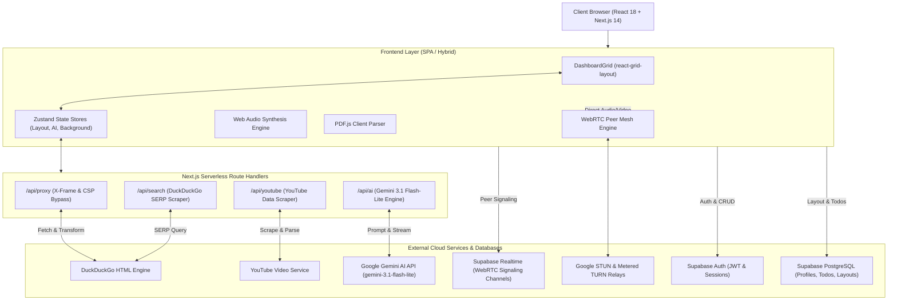
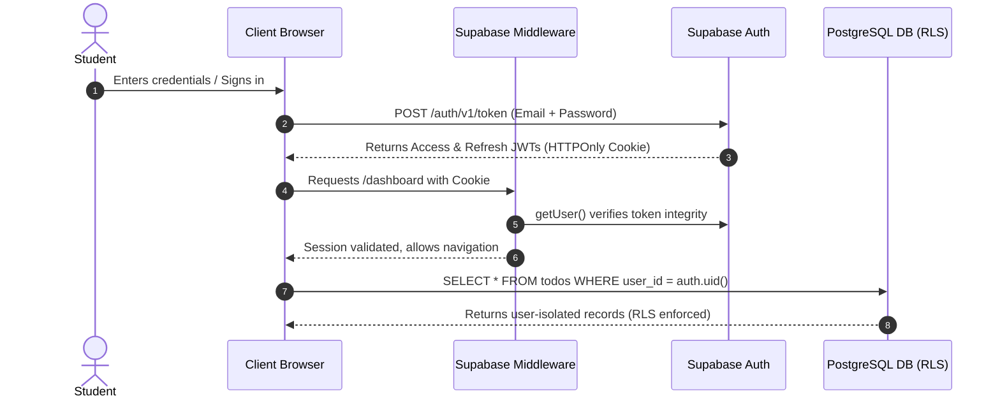

# System Architecture — Study Dashboard

## 1. High-Level Architecture Overview

Study Dashboard follows a modern, decoupled client-server architecture built on Next.js 14 App Router, combining client-side spatial UI management with serverless APIs, Supabase real-time infrastructure, and external AI/Search pipelines.



---

## 2. Technology Stack & Decision Matrix

| Layer | Technology | Primary Rationale |
|---|---|---|
| **Framework** | Next.js 14 (App Router) | Hybrid Server Components + Client SPA hydration; zero-config serverless API endpoints. |
| **Language** | TypeScript 5 (Strict Mode) | Strong typing across complex grid coordinates, WebRTC signaling events, and Gemini prompts. |
| **Styling & Theme** | Tailwind CSS + CSS Variables | Glassmorphism UI tokens (`glass-card`, `glass-border`, `shadow-glow`), responsive utility classes. |
| **Animations** | Framer Motion | Smooth layout transforms (`layoutId`), modal morphing for Study Calls, and backdrop transitions. |
| **Canvas Layout** | `react-grid-layout` v1.x (Pinned) | Robust 2D draggable/resizable matrix with coordinate serialization; v1 pinned for stability. |
| **State Management** | Zustand | Decentralized stores (`useLayoutStore`, `useAIContextStore`, `useBackgroundStore`) with selective re-rendering. |
| **Database & Auth** | Supabase (PostgreSQL 15) | Instant authentication, Row-Level Security, automated triggers, and WebSocket Realtime channels. |
| **AI LLM Engine** | Google Gemini API | Low-latency response times (`gemini-3.1-flash-lite`), generous free tier tokens, 1M context window. |
| **Document Processing** | `pdfjs-dist` (Worker) | Completely client-side PDF text extraction without transmitting private student notes to servers. |
| **Audio Processing** | Web Audio API | Zero-dependency procedural synthesis of mechanical clock ticks and harmonic bell tones. |

---

## 3. Component Hierarchy & Module Structure

```
components/
├── dashboard/
│   ├── DashboardGrid.tsx           # Grid container with WidthProvider & context menu
│   ├── BackgroundLayer.tsx         # Fixed wallpaper layer with dynamic blur and dimming
│   ├── BackgroundPickerModal.tsx   # Atmosphere preset selector & custom image uploader
│   ├── BackgroundPickerButton.tsx  # Header trigger for background manager
│   ├── AdminUserTable.tsx          # Role-based admin access control table
│   └── SignOutButton.tsx           # Session invalidation trigger
├── providers/
│   ├── AuthProvider.tsx            # Supabase user profile context & JWT state
│   └── MotionProvider.tsx          # Global Framer Motion animation configuration
├── ui/
│   └── WidgetChrome.tsx            # Unified glassy container with title, actions & controls
└── widgets/
    ├── PomodoroTimer.tsx           # Analog SVG dial with synthesized Web Audio ticks
    ├── TodoList.tsx                # Task checklist synced with Supabase
    ├── AIAssistant.tsx             # Interactive Gemini chat, Flashcards, Quiz & PYQ UI
    ├── DocumentViewer.tsx          # PDF viewer, Web browser & YouTube video explorer
    ├── StudyCallRoom.tsx           # WebRTC mesh calling with peer chat & screen modal
    ├── DigitalTimer.tsx            # Continuous study stopwatch
    └── MusicWidget.tsx             # YouTube playlist & audio streamer
```

---

## 4. Subsystem Architectures

### 4.1 State Management (Zustand Stores)
1. **`useLayoutStore` (`store/useLayoutStore.ts`):**
   - Manages active widget layout coordinates `LayoutItem[]`.
   - Debounces database writes to `profiles.dashboard_layout` by 1000ms.
   - Provides optimistic local state updates on drag/resize events.
   - Exposes `removeWidget`, `addWidget`, and `resetLayout`.

2. **`useAIContextStore` (`store/useAIContextStore.ts`):**
   - Bridges the Document Viewer and AI Assistant widgets.
   - When a user triggers "Flashcards", "Quiz", or "PYQ AI", extracted text and metadata are dispatched to this store, automatically activating the AI Assistant.

3. **`useBackgroundStore` (`store/useBackgroundStore.ts`):**
   - Stores active wallpaper URL, custom user uploads, dark dimming opacity (0–75%), and blur radius (0–12px).
   - Automatically synchronizes with browser `localStorage`.

### 4.2 WebRTC Peer Study Room Signaling
- Rooms are designated by unique 6-character alphameric keys.
- Supabase Realtime Channels (`study-room:${roomCode}`) serve as the signaling server.
- Exchange sequence:
  1. Peer A initiates room and listens on the broadcast channel.
  2. Peer B joins, generating an SDP `offer` broadcast over the channel.
  3. Peer A receives `offer`, generates SDP `answer`, and transmits via channel.
  4. Both peers exchange ICE candidates over the channel to establish P2P connection via STUN/TURN.

### 4.3 Proxy, Scraping & Route Shim Pipeline (`/api/proxy`)
- **SSRF Protection:** Filters out private IP ranges (`10.0.0.0/8`, `192.168.0.0/16`, `127.0.0.1`, localhost).
- **Header Sanitization:** Strips restrictive `X-Frame-Options` and `Content-Security-Policy` headers.
- **Client Script Injection:**
  - Injects `<base href="...">` ensuring relative assets resolve to the target host.
  - Rewrites root-relative `window.fetch` and `XMLHttpRequest.open` to route through `/api/proxy` to circumvent browser CORS limits.
  - Executes `window.history.replaceState` synchronizing iframe pathnames with target URLs to prevent Single Page App (Remix/Next.js) router crashes.
  - Intercepts OAuth / Login links in the capture phase to open them in native browser tabs.

---

## 5. Security & Authentication Model



- **Row Level Security (RLS):** Every database table (`profiles`, `todos`, `study_rooms`, `messages`) enforces strict `auth.uid() = user_id` isolation.
- **Role-Based Access Control (RBAC):** Admin dashboard is guarded by server-side profile role validation (`profile.role === 'admin'`).
- **Server-Side API Key Secrecy:** `GEMINI_API_KEY` and Supabase Service Role keys remain strictly server-side within Next.js API route handlers.
