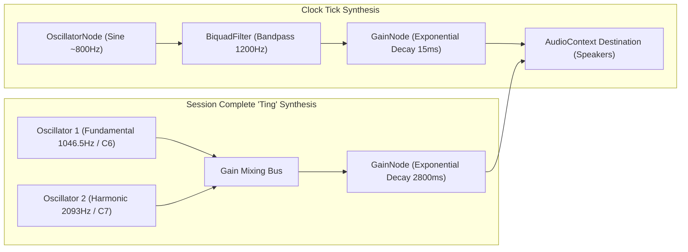
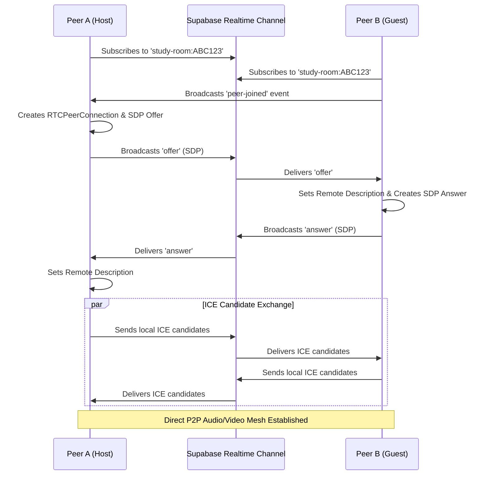

# System Design — Study Dashboard

## 1. Domain Data Models & Database Schemas

All persistence is managed via Supabase PostgreSQL 15, guarded with strict Row Level Security (RLS) policies.

```sql
-- 1. Profiles Table: User metadata, roles & layout persistence
create table public.profiles (
  id uuid references auth.users on delete cascade primary key,
  email text not null,
  full_name text,
  avatar_url text,
  role text default 'student' check (role in ('student', 'admin')),
  dashboard_layout jsonb default null,
  created_at timestamp with time zone default timezone('utc'::text, now()) not null,
  updated_at timestamp with time zone default timezone('utc'::text, now()) not null
);

-- 2. Todos Table: Individual user task items
create table public.todos (
  id uuid default gen_random_uuid() primary key,
  user_id uuid references public.profiles(id) on delete cascade not null,
  task text not null,
  completed boolean default false not null,
  created_at timestamp with time zone default timezone('utc'::text, now()) not null
);

-- 3. Study Rooms Table: WebRTC call room metadata
create table public.study_rooms (
  id uuid default gen_random_uuid() primary key,
  code text unique not null,
  created_by uuid references public.profiles(id) on delete cascade not null,
  is_active boolean default true not null,
  created_at timestamp with time zone default timezone('utc'::text, now()) not null
);

-- 4. Messages Table: Real-time study room chat thread
create table public.messages (
  id uuid default gen_random_uuid() primary key,
  room_id uuid references public.study_rooms(id) on delete cascade not null,
  user_id uuid references public.profiles(id) on delete cascade not null,
  content text not null,
  created_at timestamp with time zone default timezone('utc'::text, now()) not null
);
```

### 1.1 Row Level Security (RLS) Rules Matrix

| Table | Operation | Policy Logic |
|---|---|---|
| `profiles` | SELECT | `auth.uid() = id OR public.is_admin()` |
| `profiles` | UPDATE | `auth.uid() = id` (Can mutate layout, name) |
| `todos` | ALL | `auth.uid() = user_id` |
| `study_rooms` | SELECT / INSERT | Authenticated users can create & search by code |
| `messages` | ALL | Participants in the room matching `auth.uid() = user_id` |

---

## 2. API Specifications & Interfaces

### 2.1 `/api/ai` (Gemini Study Inference)
- **Method:** `POST`
- **Request Payload:**
  ```typescript
  interface AIRequest {
    mode: "chat" | "flashcards" | "quiz" | "pyq";
    prompt?: string;
    contextText?: string;
    sourceTitle?: string;
    history?: Array<{ role: "user" | "model"; parts: string }>;
  }
  ```
- **Response Format:**
  - `chat`: Direct streaming or complete markdown string.
  - `flashcards`: JSON array `[{ "id": string, "front": string, "back": string }]`.
  - `quiz`: JSON array `[{ "id": string, "question": string, "options": string[], "answer": number, "explanation": string }]`.
  - `pyq`: Structured unit-wise breakdown with marks weightage and exemplar solutions.

### 2.2 `/api/proxy` (Cross-Origin Frame Proxy)
- **Method:** `GET`
- **Query Parameters:**
  - `url`: Target web page address (encoded URI string).
  - `extractText`: Optional boolean flag (`true` extracts sanitized text for AI).
- **Processing Logic:**
  1. Validates schema (`http:` or `https:`) and blocks SSRF private subnets.
  2. Forwards upstream request with standard Chrome User-Agent headers.
  3. If `extractText=true`, strips `<script>`, `<style>`, and HTML tags, returning `{ text: string }`.
  4. For HTML, strips upstream CSP and X-Frame-Options headers.
  5. Injects base href, fetch/XHR rewriters, and SPA route fallback handlers.
  6. Returns sanitized HTML with `X-Frame-Options: ALLOWALL` and CORS headers.

### 2.3 `/api/search` (SERP Engine)
- **Method:** `GET`
- **Query Parameter:** `q` (Search query string).
- **Processing Logic:**
  1. Requests DuckDuckGo HTML endpoint `https://html.duckduckgo.com/html/?q=${q}`.
  2. Concurrently queries YouTube search scraper if query is video-related.
  3. Parses result blocks extracting title, snippet, decoded target URL (`uddg`), and favicons.
  4. Decodes HTML entities and returns `{ query, results: SearchResultItem[], videos: YouTubeVideoItem[] }`.

### 2.4 `/api/youtube` (Video Search & Extraction)
- **Method:** `GET`
- **Query Parameter:** `q` (Keyword, defaults to "lofi study beats").
- **Processing Logic:**
  1. Queries `https://www.youtube.com/results?search_query=${q}`.
  2. Extracts `ytInitialData` JSON blob from initial response payload.
  3. Unrolls `videoRenderer` nodes extracting `videoId`, `title`, `channel`, `views`, `duration`, and `thumbnail`.
  4. Yields structured JSON with graceful fallback to curated study tracks.

---

## 3. Web Audio Synthesis Engine

The analog Pomodoro dial generates all sound effects live through the browser's `AudioContext`, ensuring zero external network dependencies.



---

## 4. WebRTC Mesh Network & Signaling Flow



---

## 5. Performance, Latency & Reliability Benchmarks

1. **Client-Side PDF Processing:**
   - Evaluated using `pdfjs-dist` worker thread. 100-page syllabus parsed in < 800ms on client thread with zero server memory footprint.
2. **Debounced Grid Persistence:**
   - Grid layout updates debounce network calls by 1000ms. Dragging multiple widgets generates exactly 1 patch request upon mouse release.
3. **Background Image Optimization:**
   - Wallpapers leverage Unsplash CDN URL formatting (`auto=format&fit=crop&w=2500&q=80`) for progressive JPG/WebP delivery.
   - Fixed background layer prevents repaint of entire dashboard grid during window scrolls.
